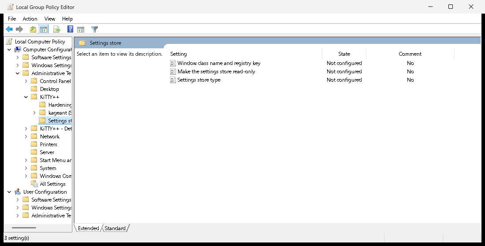
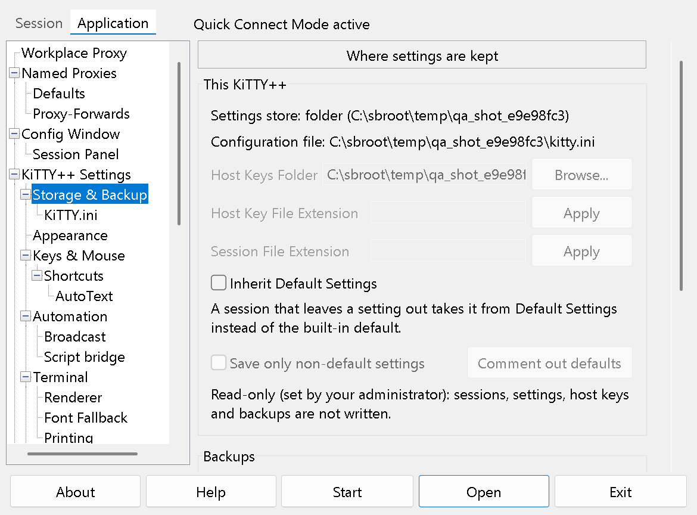
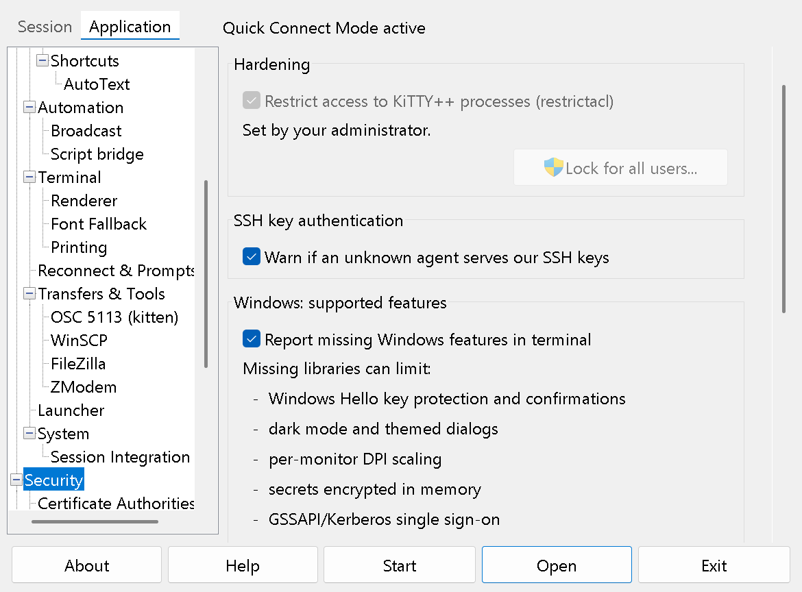
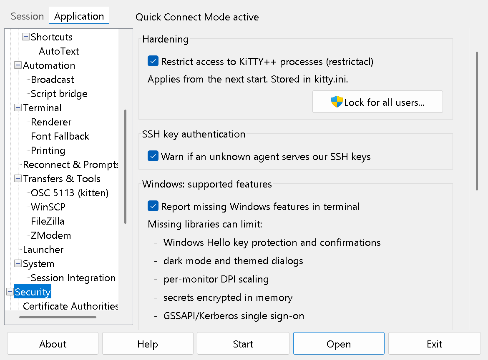
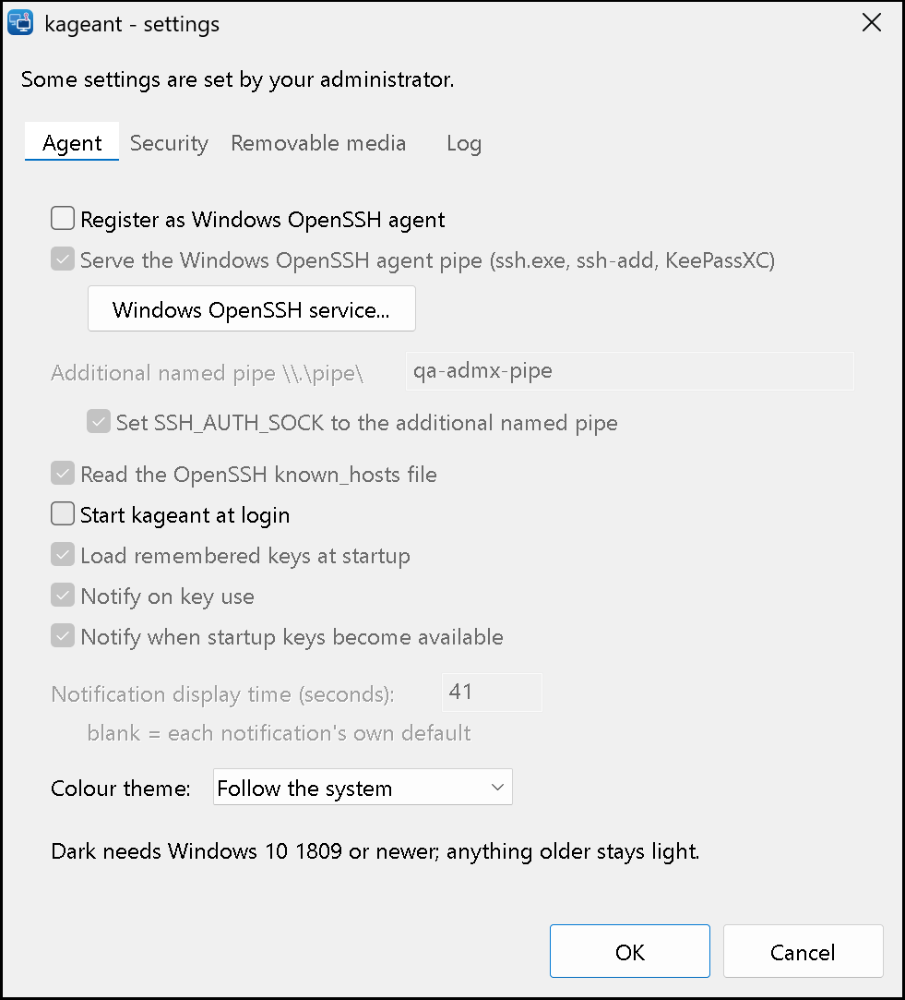
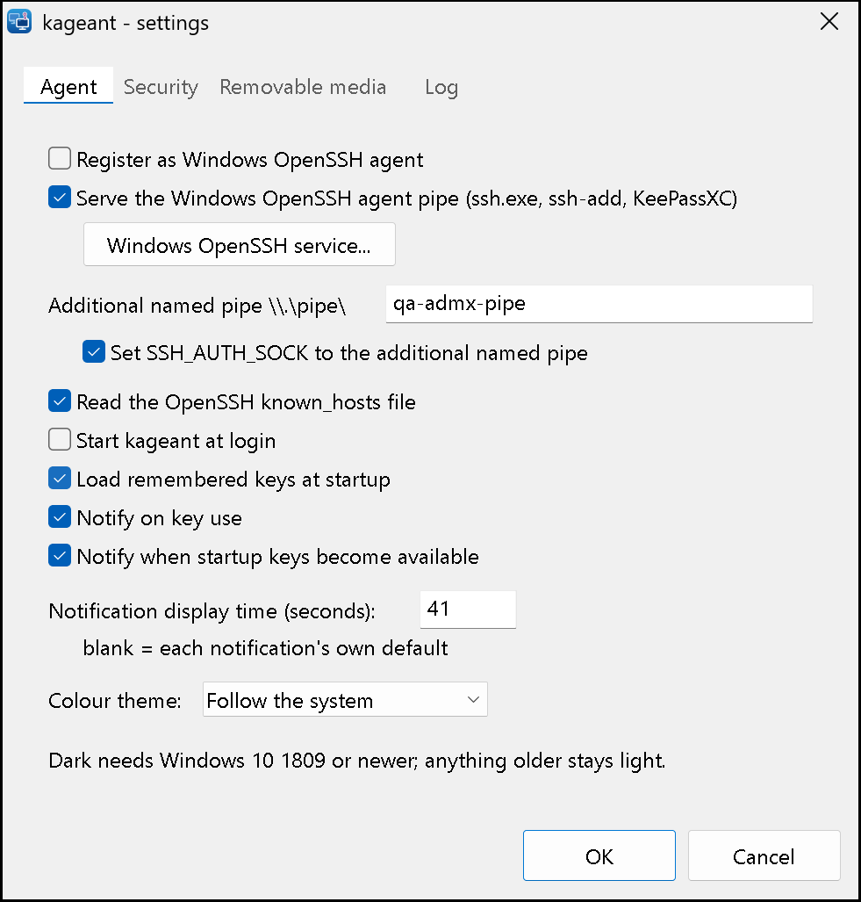
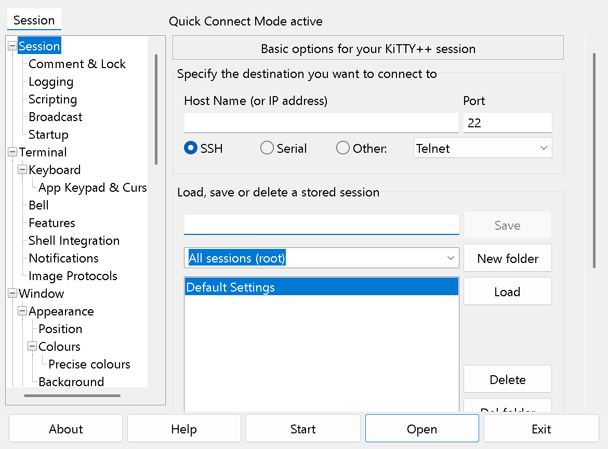
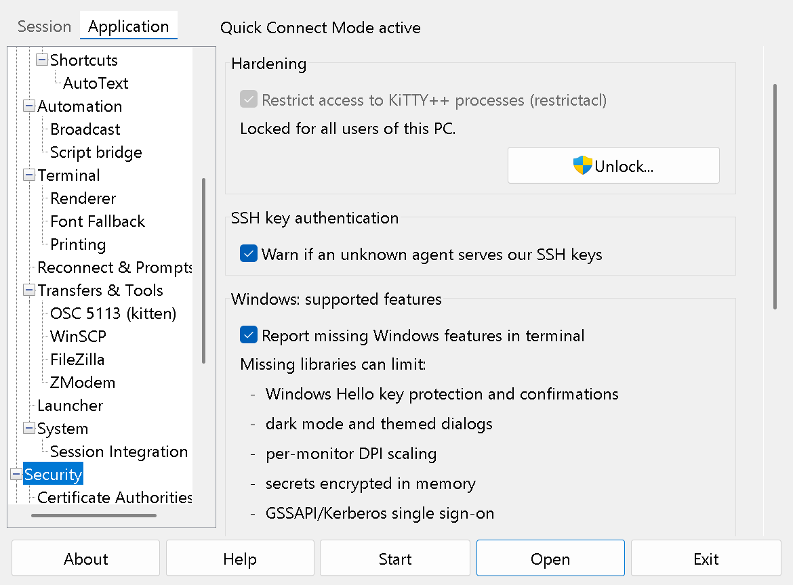

# Group Policy for KiTTY++ and kageant

For administrators of a domain, of Intune-managed devices or of a single
computer. This guide shows how to manage the settings of KiTTY++ and kageant
centrally: with the Administrative Template (an `.admx` file and its `.adml`
language file), with Microsoft Intune, or with registry values set by a
script.

- [How policies apply](#how-policies-apply)
- [The template files](#the-template-files)
- [One computer: the Local Group Policy Editor](#one-computer-the-local-group-policy-editor)
- [A domain: the Central Store and the Group Policy Management Console](#a-domain-the-central-store-and-the-group-policy-management-console)
- [Microsoft Intune](#microsoft-intune)
- [Without the template: registry values from a script](#without-the-template-registry-values-from-a-script)
- [What users see](#what-users-see)
- [The settings store](#the-settings-store)
- [The machine lock for restrictacl](#the-machine-lock-for-restrictacl)
- [Verifying the applied policies](#verifying-the-applied-policies)
- [All policies of the template](#all-policies-of-the-template)


## How policies apply

KiTTY++ and kageant read two registry keys before their own settings:

| Key | Set through |
|---|---|
| `HKLM\Software\Policies\kapper.net\KiTTY++` | Computer Configuration: all users of the computer |
| `HKCU\Software\Policies\kapper.net\KiTTY++` | User Configuration: the current user |

A value in these keys is a **mandatory** policy. The programs use it, grey
out the matching control and do not save changes to it. Computer policies
take precedence over user policies.

The `Recommended` subkey of either key holds **recommended** policies:
defaults the user can override. A recommended value applies only while the
user has not set a value. Its control is not greyed out.

Precedence for every global setting:

1. a mandatory policy (HKLM, then HKCU),
2. the user's own value (the registry store or `kitty.ini`, in the folder
   store `kitty.ini` only),
3. a recommended policy (HKLM, then HKCU, subkey `Recommended`),
4. the built-in default.

Per-session settings (a host name, a session's colours) cannot be set by
policy.

The template covers the settings store, the hardening options and kageant's
agent settings. Every other global setting can be enforced the same way
without the template: the value name is the setting's name in `kitty.ini`,
with the type `REG_SZ`. Settings of the `[Print]` and `[FontFallback]`
sections go into a subkey of that name, for example
`...\KiTTY++\FontFallback`. [docs/KITTY-INI.md](KITTY-INI.md) lists the
names.

`Software\Policies` is shared by 32-bit and 64-bit programs (no registry
redirection), so the 32-bit build reads the same values.

Policy changes take effect when KiTTY++ and kageant are started again.


## The template files

| File | Content |
|---|---|
| `windows/policy/kittypp.admx` | the policy definitions, categories and registry values |
| `windows/policy/en-US/kittypp.adml` | the English language resources |

Releases after 0.85.1.21 provide them as a separate download,
`kittypp-policy-templates-<version>.zip`: the two files as of the release
tag, with a short README. The program packages (MSI, ZIP) do not include
them.

In the source tree both files are generated by `tools/gen-admx.py`, which
also generates the table at the end of this page. The build and the release
verify that the three files match the generator. They also verify that the
programs still read every value name the template sets.

The template is self-contained: it has its own namespace
(`kapper.net.Policies.KiTTYpp`) and references no Windows `.admx` file.
Every policy is available under Computer Configuration and under User
Configuration.

The editor shows the policies in two categories:

- **KiTTY++**: the mandatory policies, with the subcategories Settings store,
  Hardening and kageant (SSH agent).
- **KiTTY++ - Default Settings (users can override)**: the same settings as
  recommended policies. The three settings store policies are not included:
  they determine where the user's settings are stored, so only a mandatory
  policy is meaningful.


## One computer: the Local Group Policy Editor

1. Copy `kittypp.admx` to `C:\Windows\PolicyDefinitions`.
2. Copy `en-US\kittypp.adml` to `C:\Windows\PolicyDefinitions\en-US`.
   Both folders require administrator rights.
3. Press Win+R and run `gpedit.msc`. The Local Group Policy Editor opens.
   It is included in Windows Pro, Enterprise and Education.
4. Open **Computer Configuration > Administrative Templates > KiTTY++** for
   all users of this computer, or **User Configuration > Administrative
   Templates > KiTTY++** for the users this local policy applies to.
5. Double-click a policy, select **Enabled**, set the value and click OK.



**Not Configured** removes the value: the user's own value applies again.
For an on/off policy, **Disabled** writes its "off" value, which is a
mandatory policy as well.

`gpupdate /force` applies changed policies immediately instead of at the
next refresh interval.


## A domain: the Central Store and the Group Policy Management Console

1. Copy the two files into the domain's Central Store, on a domain
   controller or through the SYSVOL share:
   - `\\<domain>\SYSVOL\<domain>\Policies\PolicyDefinitions\kittypp.admx`
   - `\\<domain>\SYSVOL\<domain>\Policies\PolicyDefinitions\en-US\kittypp.adml`

   If the domain has no Central Store, create it first: the
   `PolicyDefinitions` folder with the contents of
   `C:\Windows\PolicyDefinitions` from a current Windows version. See
   Microsoft's
   [Create and Manage Central Store](https://learn.microsoft.com/en-us/troubleshoot/windows-client/group-policy/create-and-manage-central-store).
   SYSVOL replication copies it to all domain controllers.
2. Open the **Group Policy Management** console (`gpmc.msc`) on a domain
   controller, or on a workstation with the Remote Server Administration
   Tools (feature "Group Policy Management Tools").
3. Create a Group Policy Object, link it to the organizational unit that
   contains the computers or users, then click **Edit**. The Group Policy
   Management Editor shows the same categories as the local editor, under
   **Policies > Administrative Templates > KiTTY++**.
4. Configure the policies as above. Computer Configuration applies to the
   computers in the linked organizational unit, User Configuration to its
   users.

To update the template, replace the two files in the Central Store.
Configured policies keep their values.


## Microsoft Intune

Intune can import a custom template ("Import ADMX", in public preview at the
time of writing). We have not tested it in a tenant. The steps follow
Microsoft's
[Import custom ADMX and ADML administrative templates](https://learn.microsoft.com/en-us/intune/intune-service/configuration/administrative-templates-import-custom):

1. In the Intune admin center: **Devices > Manage devices > Configuration >
   Import ADMX > Import**.
2. Upload `kittypp.admx` and `en-US\kittypp.adml`. No other `.admx` file is
   required first: the template references none.
3. When the import status is Available: **Create > New policy**, platform
   **Windows 10 and later**, profile type **Templates > Imported
   Administrative templates (Preview)**.
4. Configure the policies and assign the profile. Assigned to a device
   group, it applies to all users of those devices. Assigned to a user group,
   it applies to those users on their devices.

Microsoft's limits that apply to this template: `en-US` `.adml` files only,
one `.adml` per `.admx`, 1 MB per file. A newer KiTTY++ template with the
same namespace cannot be imported over the old one: delete the profiles that
use it, delete the imported template, then import the new files.

Without the import, an Intune script running as SYSTEM can write the values
directly, as described in the next section.


## Without the template: registry values from a script

The policy keys accept plain registry values. `reg add` from any process
with write access:

```bat
:: mandatory for all users of the computer
reg add "HKLM\Software\Policies\kapper.net\KiTTY++" /v readonly /t REG_SZ /d yes /f
reg add "HKLM\Software\Policies\kapper.net\KiTTY++" /v ConfirmKeyUse /t REG_DWORD /d 1 /f

:: recommended: a default the user can override
reg add "HKLM\Software\Policies\kapper.net\KiTTY++\Recommended" /v restrictacl /t REG_SZ /d yes /f

:: a setting of the [FontFallback] section
reg add "HKLM\Software\Policies\kapper.net\KiTTY++\FontFallback" /v active /t REG_SZ /d no /f

:: removed: the user's own value applies again
reg delete "HKLM\Software\Policies\kapper.net\KiTTY++" /v readonly /f
```

Required permissions:

- `HKLM\Software\Policies` requires administrator rights: a computer startup
  script, a software deployment, an Intune script running as SYSTEM.
- `HKCU\Software\Policies` is **read-only for the user** (Windows grants
  the user read access only). A logon script runs as the user, so it cannot
  set a policy there. It can only set the user's own values, which the user
  can change.
- Group Policy Preferences, **User Configuration > Preferences > Windows
  Settings > Registry**, can write it: a user preference item runs as SYSTEM
  unless "Run in logged-on user's security context" is selected.
  [Microsoft: Working with Group Policy Preference items](https://learn.microsoft.com/en-us/previous-versions/windows/it-pro/windows-server-2012-r2-and-2012/dn789194(v=ws.11)).

A setting KiTTY++ reads as yes or no is a `REG_SZ` with `yes` or `no`.
kageant's on/off settings are a `REG_DWORD` with 1 or 0. A number is a
`REG_DWORD`, or a `REG_SZ` containing the number. The table at the end lists
the registry type of every template policy. An empty `REG_SZ` counts as not
set.


## What users see

A mandatory policy greys out its control. The panel or dialog shows a note
that the administrator set it.

The Storage & Backup panel under a mandatory `readonly=yes`:



Application > Security, `restrictacl=yes` as a mandatory policy: the
Hardening group's check box is greyed out with "Set by your administrator."



The same setting as a recommended policy: selected, not greyed out. The user
can clear it.



kageant's settings dialog with mandatory policies: every control a policy
sets is greyed out, with "Some settings are set by your administrator."



The same values as recommended policies: the controls are enabled and show
the administrator's values.



**Hide the Application tab** (`applicationsettings`): the configuration
window has no Application tab. Its panels are not created.



Commands and buttons that would change a value set by policy are rejected,
with a reference to the administrator:

- `/savemode` under a mandatory `savemode`: `Savemode is "dir": set by your
  administrator`.
- Under a mandatory `readonly=yes`: Save, the store commands and
  `-fileassoc` save nothing ("Not registered: the settings store is
  read-only (set by your administrator).").
- `/help` marks such commands with "(set by your administrator)".
- kageant's tray menu items for notifications, confirmation and remembered
  keys are greyed out when a policy sets them, as are the confirmation
  option buttons in the key list.


## The settings store

Three policies determine where KiTTY++ stores its sessions and settings.
All KiTTY++ programs apply them, including `kitty_portable.exe`.

- **Settings store type** (`savemode`): `registry`, `dir` (one file per
  session in the program folder, the portable store) or `file` (legacy
  mode). `/savemode` and the store buttons are rejected.
- **Make the settings store read-only** (`readonly`): no program writes to
  the store. Changes apply to the running process only. Disabled overrides
  a `readonly=yes` in `kitty.ini`.
- **Window class name and registry key** (`KiClassName`): `PuTTY` makes
  KiTTY++ register the PuTTY window class and use the PuTTY registry key
  (`Software\SimonTatham\PuTTY`), shared with an installed PuTTY.

These three have no recommended form.


## The machine lock for restrictacl

`restrictacl=yes` restricts the access rights other processes of the same
user have to kitty.exe and kageant (the process ACL), like the
`-restrict-acl` command-line option. Besides a policy there is a second way
to enforce it for all users of a computer: the **machine lock**, the value
`restrictacl` in `HKLM\Software\kapper.net\KiTTY++`.

Precedence for this setting: a mandatory policy, then the machine lock, then
`kitty.ini` (its `[KiTTY] restrictacl`), then a recommended policy. The
user's registry hive is never read for it: a stale value there could
override the lock.

**Set it:** Application > Security > Hardening > **Lock for all users...**
A UAC prompt requests administrator rights. Then the panel shows "Locked
for all users of this PC." and the button changes to **Unlock...**.



The button runs `kitty.exe -machinelock restrictacl=yes` elevated. The same
from an elevated command prompt or a deployment script:

```bat
kitty.exe -machinelock restrictacl=yes
```

**Remove it:** the **Unlock...** button, or from an elevated command
prompt:

```bat
kitty.exe -machinelock restrictacl=
:: or
reg delete "HKLM\Software\kapper.net\KiTTY++" /v restrictacl /f
```

`-machinelock` accepts only this one name, with `yes` or an empty value.
Exit code 0: success. Exit code 1: failure (no administrator rights, another
name or value). It writes to the 64-bit registry view, which both builds
read.

Setting or removing the lock takes effect at the next start of each program:
a running process cannot relax its own restriction. A mandatory policy takes
precedence: under a policy the button is greyed out.


## Verifying the applied policies

- `gpresult /h report.html` (from an elevated command prompt for the computer
  part) generates a report of the applied Group Policy Objects and their
  settings. `gpresult /r` shows a summary. [Microsoft: gpresult](https://learn.microsoft.com/en-us/windows-server/administration/windows-commands/gpresult)
- `gpupdate /force` applies the policies again immediately.
  [Microsoft: gpupdate](https://learn.microsoft.com/en-us/windows-server/administration/windows-commands/gpupdate)
- The registry values:
  `reg query "HKLM\Software\Policies\kapper.net\KiTTY++" /s` and the same
  under `HKCU`.
- In KiTTY++: a greyed-out control with the administrator note shows that
  the policy value was applied.


## All policies of the template

Value names are relative to `Software\Policies\kapper.net\KiTTY++`. A policy
with "yes" in the last column is also available under "KiTTY++ - Default
Settings (users can override)", which writes to the `Recommended` subkey.

<!-- gen-admx: the table below is written by tools/gen-admx.py -->
| Policy | Folder | Value name | Type and values | Recommended |
|---|---|---|---|---|
| Settings store type | KiTTY++ > Settings store | `savemode` | REG_SZ: registry, dir, file | no |
| Make the settings store read-only | KiTTY++ > Settings store | `readonly` | REG_SZ: yes, no | no |
| Window class name and registry key | KiTTY++ > Settings store | `KiClassName` | REG_SZ: up to 64 characters | no |
| Restrict access to KiTTY++ processes | KiTTY++ > Hardening | `restrictacl` | REG_SZ: yes, no | yes |
| Hide the Application tab | KiTTY++ > Hardening | `applicationsettings` | REG_SZ: no (Enabled), yes (Disabled) | yes |
| Require confirmation for key use | KiTTY++ > kageant (SSH agent) > Keys and notifications | `ConfirmKeyUse` | REG_DWORD: 0 Keys that request it, 1 Every key use, 2 Never | yes |
| Confirm key use with Windows Hello | KiTTY++ > kageant (SSH agent) > Keys and notifications | `HelloConfirm` | REG_DWORD: 1 on, 0 off | yes |
| Notify on key use | KiTTY++ > kageant (SSH agent) > Keys and notifications | `NotifyOnKeyUse` | REG_DWORD: 1 on, 0 off | yes |
| Notify when startup keys become available | KiTTY++ > kageant (SSH agent) > Keys and notifications | `NotifyOnKeyArrival` | REG_DWORD: 1 on, 0 off | yes |
| Notification display time | KiTTY++ > kageant (SSH agent) > Keys and notifications | `NoticeTimeout` | REG_DWORD: 2 to 120, default 8 | yes |
| Load remembered keys at startup | KiTTY++ > kageant (SSH agent) > Keys and notifications | `LoadKeysOnStartup` | REG_DWORD: 1 on, 0 off | yes |
| Load startup keys from newly attached drives | KiTTY++ > kageant (SSH agent) > Keys and notifications | `RetryKeys` | REG_DWORD: 0 Never, 1 From the stored path, 2 From any drive letter | yes |
| Unload keys when their drive is removed | KiTTY++ > kageant (SSH agent) > Keys and notifications | `UnloadOnRemove` | REG_DWORD: 1 on, 0 off | yes |
| Suppress notifications for missing startup keys | KiTTY++ > kageant (SSH agent) > Keys and notifications | `QuietMissingKeys` | REG_DWORD: 1 on, 0 off | yes |
| Passphrase cache time | KiTTY++ > kageant (SSH agent) > Keys and notifications | `PassphraseCacheSeconds` | REG_DWORD: 0 to 300, default 60 | yes |
| Windows Hello cache time | KiTTY++ > kageant (SSH agent) > Keys and notifications | `HelloCacheSeconds` | REG_DWORD: 0 to 300, default 60 | yes |
| Re-encrypt idle keys | KiTTY++ > kageant (SSH agent) > Keys and notifications | `AutoEncryptMode` | REG_DWORD: 0 Off, 1 Keys without their own timeout, 2 All keys | yes |
| Re-encryption timeout | KiTTY++ > kageant (SSH agent) > Keys and notifications | `AutoEncryptSeconds` | REG_DWORD: 1 to 604800, default 600 | yes |
| Action when Windows is locked | KiTTY++ > kageant (SSH agent) > Keys and notifications | `LockWithWindows` | REG_DWORD: 0 No action, 1 Lock the agent, 2 Re-encrypt the keys | yes |
| Read the OpenSSH known_hosts file | KiTTY++ > kageant (SSH agent) > Keys and notifications | `ReadKnownHosts` | REG_DWORD: 1 on, 0 off | yes |
| Block keys added by client programs | KiTTY++ > kageant (SSH agent) > Requests from client programs | `BlockIpcAdd` | REG_DWORD: 1 on, 0 off | yes |
| Block key removal by client programs | KiTTY++ > kageant (SSH agent) > Requests from client programs | `BlockIpcRemove` | REG_DWORD: 1 on, 0 off | yes |
| Allow client programs to lock the agent | KiTTY++ > kageant (SSH agent) > Requests from client programs | `AllowIpcLock` | REG_DWORD: 1 on, 0 off | yes |
| Block changes through agent forwarding | KiTTY++ > kageant (SSH agent) > Requests from client programs | `BlockForwardedChanges` | REG_DWORD: 1 on, 0 off | yes |
| Allow requests by window messages | KiTTY++ > kageant (SSH agent) > Requests from client programs | `AllowWmCopyData` | REG_DWORD: 1 on, 0 off | yes |
| Serve the Windows OpenSSH agent pipe | KiTTY++ > kageant (SSH agent) > Requests from client programs | `OpenSSHPipe` | REG_DWORD: 1 on, 0 off | yes |
| Additional named pipe | KiTTY++ > kageant (SSH agent) > Requests from client programs | `ExtraPipe` | REG_SZ: up to 200 characters | yes |
| Set SSH_AUTH_SOCK | KiTTY++ > kageant (SSH agent) > Requests from client programs | `SetSshAuthSock` | REG_DWORD: 1 on, 0 off | yes |
| Enable the agent log | KiTTY++ > kageant (SSH agent) > Agent log | `AgentLog` | REG_DWORD: 1 on, 0 off | yes |
| Agent log file path | KiTTY++ > kageant (SSH agent) > Agent log | `AgentLogPath` | REG_SZ: up to 260 characters | yes |
| Agent log destination | KiTTY++ > kageant (SSH agent) > Agent log | `AgentLogSink` | REG_SZ: file, eventlog, both | yes |
| Maximum log file size | KiTTY++ > kageant (SSH agent) > Agent log | `AgentLogMaxKB` | REG_DWORD: 16 to 1048576, default 5120 | yes |
| Number of rotated files to keep | KiTTY++ > kageant (SSH agent) > Agent log | `AgentLogKeep` | REG_DWORD: 1 to 99, default 3 | yes |
| Rotated file retention | KiTTY++ > kageant (SSH agent) > Agent log | `AgentLogExpireDays` | REG_DWORD: 0 to 3650, default 90 | yes |
<!-- gen-admx: end of the table -->
